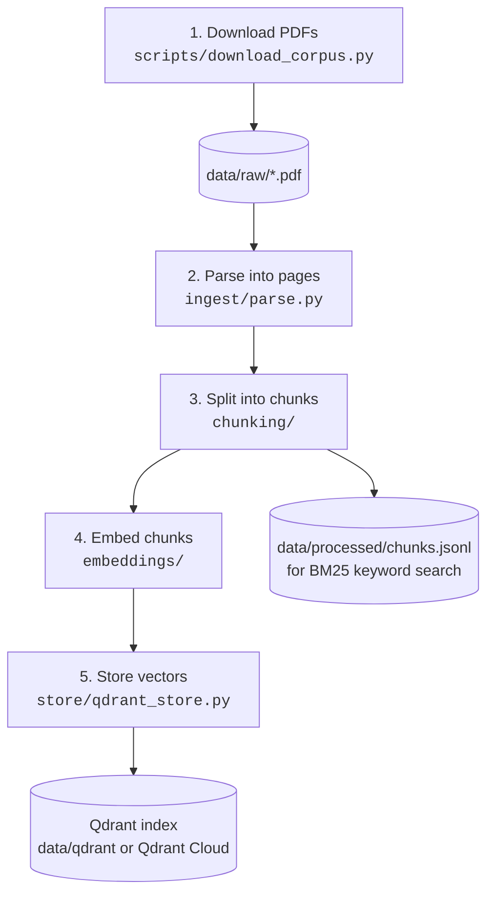
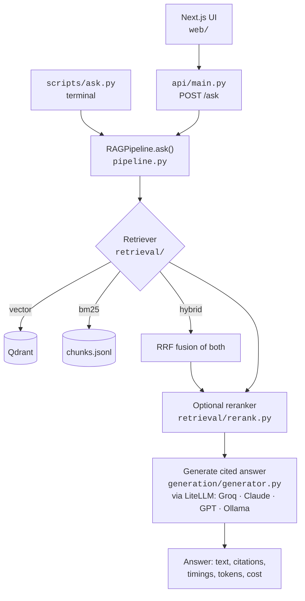
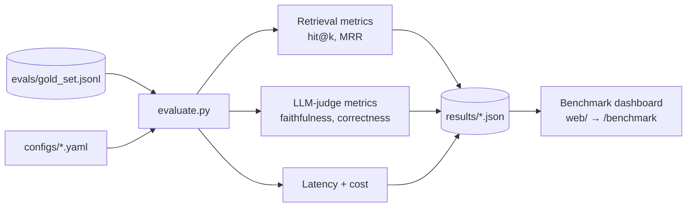

# Architecture

Two flows share one config file (`configs/*.yaml`) that decides every swappable choice.

## Flow 1 — building the index (`scripts/ingest.py`)

| Step | File | What happens |
|---|---|---|
| 1 | `scripts/download_corpus.py` | Reads `data/sources.yaml`, downloads public PDFs into `data/raw/`, lists any to save manually. |
| 2 | `src/raglab/ingest/parse.py` | PyMuPDF extracts text page by page; each page keeps `doc_id`, `title`, `page` for citations. |
| 3 | `src/raglab/chunking/` | Cuts pages into overlapping windows, preferring paragraph/sentence breaks. |
| 4 | `src/raglab/embeddings/` | Turns each chunk into a vector (local `bge-small` by default, or a hosted model via LiteLLM). |
| 5 | `src/raglab/store/qdrant_store.py` | Writes vectors + chunk text + page into Qdrant. Chunks are also saved to JSONL for BM25. |

## Flow 2 — answering a question (`scripts/ask.py` or `POST /ask`)

## Flow 3 — measuring (`scripts/evaluate.py`)

## Design rules
- Core pipeline is plain Python — every stage is a small class you can read in one sitting.
- One experiment = one YAML file in `configs/`. Comparisons stay honest because only one thing changes.
- Every answer records timings, tokens and cost; the benchmark is built from those records.
